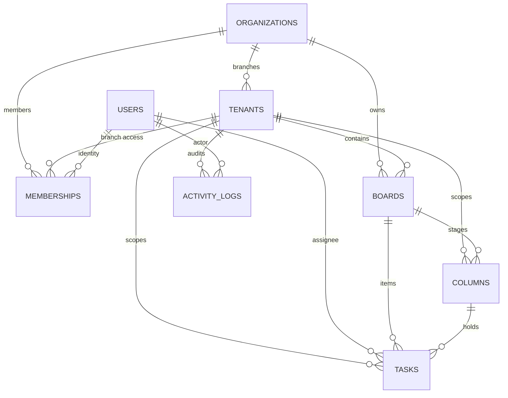

# Real-Time Collaborative Kanban Board
### Multi-Organization & Multi-Tenant Enterprise Task Management System
**Julley Online Pvt. Ltd. &bull; Assignment Submission**  
**Candidate**: Sai Ammanna Naidu  
**Contact**: naidugodasi751@gmail.com

---

## 🌟 Executive Summary

This project is a production-grade, real-time collaborative Kanban board built to satisfy enterprise multi-organization and multi-tenant (branch) requirements. It provides:
1. **Multi-Organization & Multi-Tenant Hierarchy**: `Organization` &rarr; `Tenants (Branches)` &rarr; `Boards` &rarr; `Columns` &rarr; `Tasks`.
2. **Strict Data Isolation**: Enforced at the middleware dependency layer and database query layer. Zero cross-tenant or cross-organization data leakage.
3. **Role-Based Access Control (RBAC)**: Distinct permission boundaries for **Org Admin**, **Tenant Admin**, and **Member**.
4. **Optimistic Concurrency Control (OCC)**: Atomic `version` tracking on tasks to detect concurrent collisions and present an interactive 3-way conflict resolution modal (Keep Server, Overwrite, Merge).
5. **Fractional Indexing (LexoRank)**: $O(1)$ drag-and-drop task reordering using midpoint floating-point mathematics—eliminates mass database row locks and drag-and-drop race conditions.
6. **Scoped WebSocket Channels & Live Collaboration**:
   - Tenant-isolated WebSocket rooms (`tenant:{tenant_id}:board:{board_id}`).
   - Live presence avatars showing who is online.
   - Real-time task focus indicators (*"Alice is viewing this task"*).
   - Optimistic UI updates with instant client feedback and automatic rollback on error.
7. **Client-Side Undo / Redo**: Keyboard shortcuts (`Ctrl+Z`, `Ctrl+Y`) and toolbar buttons for task movements and edits.
8. **Tenant-Scoped Audit Stream**: Immutable activity logging tracking all creations, moves, updates, and deletions.

---

## 🏛️ System Architecture

```
                                  +------------------------------------+
                                  |    Collaborative Kanban Frontend   |
                                  |   (Tailwind CSS + HTML5 DND + WS)  |
                                  +-----------------+------------------+
                                                    |
                                        REST (HTTPS) & Real-Time (WSS)
                                                    |
                                  +-----------------v------------------+
                                  |         FastAPI ASGI Server        |
                                  +--------+------------------+--------+
                                           |                  |
                    +----------------------+                  +----------------------+
                    |                                                                |
+-------------------v-------------------+                  +-------------------------v-------------------+
|            REST API Services          |                  |           Scoped WebSocket Hub              |
| - Authenticated JWT Context           |                  | - Tenant-Isolated Rooms                     |
| - Strict Tenant Access Guard (RBAC)   |                  | - Live Presence & Heartbeat Tracking        |
| - Fractional Indexing & Rebalancer    |                  | - Real-time Task Focus & Blur               |
| - Optimistic Concurrency Control (OCC)|                  | - Live Event Broadcasting                   |
+-------------------+-------------------+                  +-------------------------+-------------------+
                    |                                                                |
                    +----------------------+                  +----------------------+
                                           |                  |
                                  +--------v------------------v--------+
                                  |       SQLAlchemy ORM Database      |
                                  |     (SQLite WAL + Foreign Keys)    |
                                  +------------------------------------+
```

---

## 🗄️ Database Design & Hierarchy

### Hierarchy
`Organization` &rarr; `Tenants (Branches)` &rarr; `Boards` &rarr; `Columns` &rarr; `Tasks`

All business tables contain a mandatory `tenant_id` foreign key indexed for partition queries.



### Key Tables & Indexing
1. `organizations`: `id` (PK, UUID), `name`, `slug` (UNIQUE).
2. `tenants`: `id` (PK, UUID), `org_id` (FK), `name`, `slug`, `location`.
3. `users`: `id` (PK, UUID), `email` (UNIQUE), `name`, `hashed_password`, `avatar_color`.
4. `memberships`: `id` (PK), `user_id` (FK), `org_id` (FK), `tenant_id` (FK, nullable), `role` (`org_admin`, `tenant_admin`, `member`). Composite index on `(user_id, tenant_id)`.
5. `boards`: `id` (PK), `tenant_id` (FK, INDEX), `org_id` (FK), `name`, `description`, `color`.
6. `columns`: `id` (PK), `tenant_id` (FK), `board_id` (FK, INDEX), `title`, `order` (FLOAT, INDEX), `wip_limit`.
7. `tasks`: `id` (PK), `tenant_id` (FK, INDEX), `board_id` (FK, INDEX), `column_id` (FK, INDEX), `title`, `description`, `priority`, `order` (FLOAT, INDEX), `version` (INT, OCC), `assignee_id`, `due_date`, `tags`.
8. `activity_logs`: `id` (PK), `tenant_id` (FK, INDEX), `org_id`, `board_id`, `task_id`, `user_id`, `action`, `details` (JSON), `created_at` (INDEX).

---

## 🔐 Tenancy & Data Isolation Modeling

We evaluated three multitenancy patterns:

| Multi-Tenancy Pattern | Isolation Level | Complexity | Performance | Julley Decision |
| :--- | :--- | :--- | :--- | :--- |
| **Database per Tenant** | Physical Isolation | Extreme | High latency on branch creation | Rejected: Too heavy for branch-level scaling |
| **Schema per Tenant** | Logical Isolation | High | Complex migrations across schemas | Rejected: Not portable across SQLite/micro-DBs |
| **Shared DB + Tenant Discriminator (Chosen)** | High (Enforced via Middleware) | Low | Optimal throughput with WAL caching | **Adopted: Best balance for enterprise speed, security, and low cost** |

### How Data Leakage is Prevented:
1. **Authenticated Dependency Guard (`require_tenant_access`)**:
   - Every request targeting `/api/tenants/{tenant_id}/...` triggers authorization verification.
   - The user must either have a verified membership in `tenant_id`, OR have `org_admin` permissions in the tenant's parent organization.
   - Any cross-tenant attempt receives `403 Forbidden`.
2. **Dual-Key Query Scoping**:
   - `SELECT * FROM tasks WHERE id = :task_id AND tenant_id = :tenant_id`.
   - If an attacker guesses a task UUID belonging to another tenant, the server returns `404 Not Found`.
3. **WebSocket Room Quarantine**:
   - Handshake queries `/ws?token=...&tenant_id=...&board_id=...`.
   - Before accepting the socket, membership is validated against the database.
   - Sockets join rooms isolated strictly by `tenant:{tenant_id}:board:{board_id}`.

---

## ⚡ Concurrency & Conflict Handling (OCC & Fractional Indexing)

### 1. Optimistic Concurrency Control (OCC)
- When two users open the same task at `version 1`:
  - User A saves changes &rarr; Server accepts and sets `version = 2`.
  - User B attempts to save with stale `expected_version = 1`.
  - Server detects mismatch and responds with **HTTP 409 Conflict**.
  - The UI automatically presents a **Side-by-Side Conflict Resolution Modal**:
    - **Keep Server Version**: Discards local edits and refreshes with latest server data.
    - **Overwrite with My Changes**: Re-submits changes using the latest server version.
    - **Merge Changes**: Automatically merges non-colliding fields.

### 2. Fractional Indexing (O(1) Drag-and-Drop)
- Avoids sequentially updating all task rows when dragging a card.
- New order is computed as the midpoint between previous and next task:
  $$\text{new\_order} = \frac{\text{prev\_order} + \text{next\_order}}{2.0}$$
- Moving a task requires **only 1 database write**, preventing lock contention and drag-and-drop conflicts.
- Includes an auto-rebalancing threshold ($< 1 \times 10^{-4}$) to prevent floating-point underflow.

---

## 👥 Seeded Demo Personas (Pre-configured for Instant Evaluation)

The database is pre-seeded with realistic organizations, branches, and users.  
Use the **Quick Persona Switcher** dropdown in the top-right of the header to test roles without re-authenticating:

| Persona Name | Email | Password | Role | Access Scope |
| :--- | :--- | :--- | :--- | :--- |
| **Sai Ammanna Naidu** | `sai@julley.com` | `password123` | **Org Admin** | **All Branches** of Julley Online (Bangalore & Hyderabad) |
| **Priya Sharma** | `priya@julley.com` | `password123` | **Tenant Admin** | **Bangalore Headquarters** only |
| **Rahul Varma** | `rahul@julley.com` | `password123` | **Member** | **Bangalore Headquarters** (Contributor) |
| **Ananya Reddy** | `ananya@julley.com` | `password123` | **Tenant Admin** | **Hyderabad Innovation Hub** only |
| **John Doe** | `john@acme.com` | `password123` | **Org Admin (External)** | **Acme Cloud** (Completely isolated from Julley) |

---

## 🚀 Quick Start Guide

### 1. Prerequisites
- Python 3.10+ (Tested on Python 3.12)
- Fast pip install:
```bash
pip install -r requirements.txt
```

### 2. Start Application (Single Command)
```bash
python run.py
```
Open **`http://localhost:8000`** in your browser!

### 3. Interactive API Documentation
- **Swagger UI**: `http://localhost:8000/docs`
- **ReDoc**: `http://localhost:8000/redoc`

### 4. Run Automated Test Suite
```bash
python -m pytest -v
```
**12 passed in < 1 second**, covering:
- Tenant data isolation & cross-tenant query rejection
- Cross-organization leakage prevention
- Role-based permissions (Member vs Tenant Admin vs Org Admin)
- Optimistic Concurrency Control (OCC) 409 conflict detection
- Fractional indexing drag-drop positioning math
- WebSocket authentication and tenant room quarantine

---

## 📦 Submission Deliverables

- **Backend + Real-Time Server**: FastAPI + SQLAlchemy + SQLite WAL + Native WebSockets.
- **Frontend UI**: Responsive Kanban with HTML5 Drag-and-Drop, Slide-over Drawer, Conflict Resolution Modal, Presence Avatar Stack, Undo/Redo.
- **Database Schema**: Full ER diagram in [docs/DATABASE_SCHEMA.md](file:///C:/Users/hp/Downloads/realtime-kanban/docs/DATABASE_SCHEMA.md).
- **Architecture Documentation**: [docs/ARCHITECTURE.md](file:///C:/Users/hp/Downloads/realtime-kanban/docs/ARCHITECTURE.md).
- **API Documentation**: [docs/API_DOCUMENTATION.md](file:///C:/Users/hp/Downloads/realtime-kanban/docs/API_DOCUMENTATION.md).
- **WebSocket Protocol**: [docs/WEBSOCKET_PROTOCOL.md](file:///C:/Users/hp/Downloads/realtime-kanban/docs/WEBSOCKET_PROTOCOL.md).
- **Project ZIP Package**: Generated via `python package_zip.py` for Google Drive submission.
