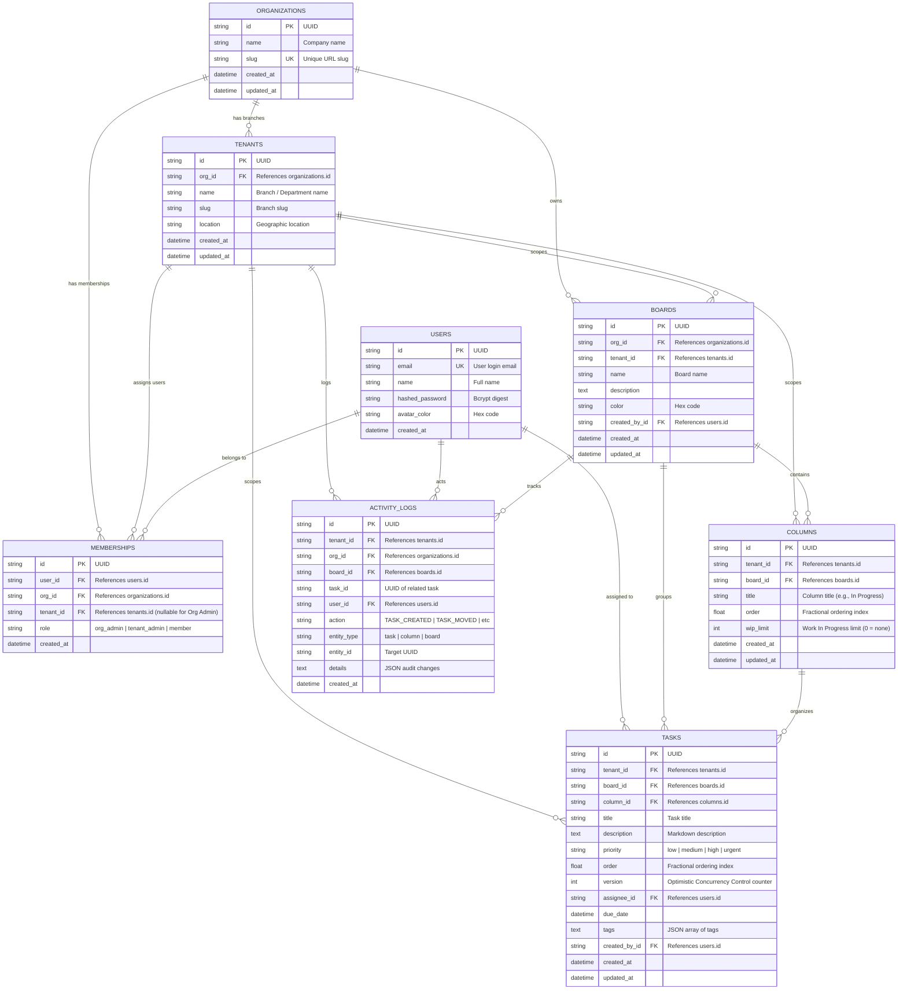

# Database Schema & Entity-Relationship (ER) Documentation

## 1. Entity-Relationship (ER) Diagram

---

## 2. Table Specifications & Indexing Strategy

### 1. `organizations`
- **Purpose**: Top-level multi-tenant container.
- **Indexes**:
  - `PRIMARY KEY (id)`
  - `UNIQUE INDEX (slug)`

### 2. `tenants`
- **Purpose**: Branch or autonomous business unit under an organization.
- **Indexes**:
  - `PRIMARY KEY (id)`
  - `INDEX (org_id)`
  - `UNIQUE CONSTRAINT (org_id, slug)`

### 3. `users`
- **Purpose**: Global user identities across organizations.
- **Indexes**:
  - `PRIMARY KEY (id)`
  - `UNIQUE INDEX (email)`

### 4. `memberships`
- **Purpose**: Junction table binding users to organizations, branches, and roles.
- **Indexes**:
  - `PRIMARY KEY (id)`
  - `INDEX ix_membership_user_tenant (user_id, tenant_id)`
  - `INDEX ix_membership_user_org (user_id, org_id)`

### 5. `boards`
- **Purpose**: Kanban boards belonging to a tenant.
- **Indexes**:
  - `PRIMARY KEY (id)`
  - `INDEX ix_boards_tenant (tenant_id)`
  - `INDEX (org_id)`

### 6. `columns`
- **Purpose**: Workflow stages within a board.
- **Indexes**:
  - `PRIMARY KEY (id)`
  - `INDEX ix_columns_board_tenant (board_id, tenant_id)`
  - `INDEX (order)`

### 7. `tasks`
- **Purpose**: Actionable items with fractional ordering and OCC versioning.
- **Indexes**:
  - `PRIMARY KEY (id)`
  - `INDEX ix_tasks_tenant_column (tenant_id, column_id)`
  - `INDEX ix_tasks_tenant_board (tenant_id, board_id)`
  - `INDEX (order)`
  - `INDEX (priority)`
  - `INDEX (assignee_id)`

### 8. `activity_logs`
- **Purpose**: Immutable audit stream scoped by tenant.
- **Indexes**:
  - `PRIMARY KEY (id)`
  - `INDEX ix_activity_tenant_created (tenant_id, created_at)`
  - `INDEX (board_id)`
  - `INDEX (task_id)`
  - `INDEX (user_id)`
